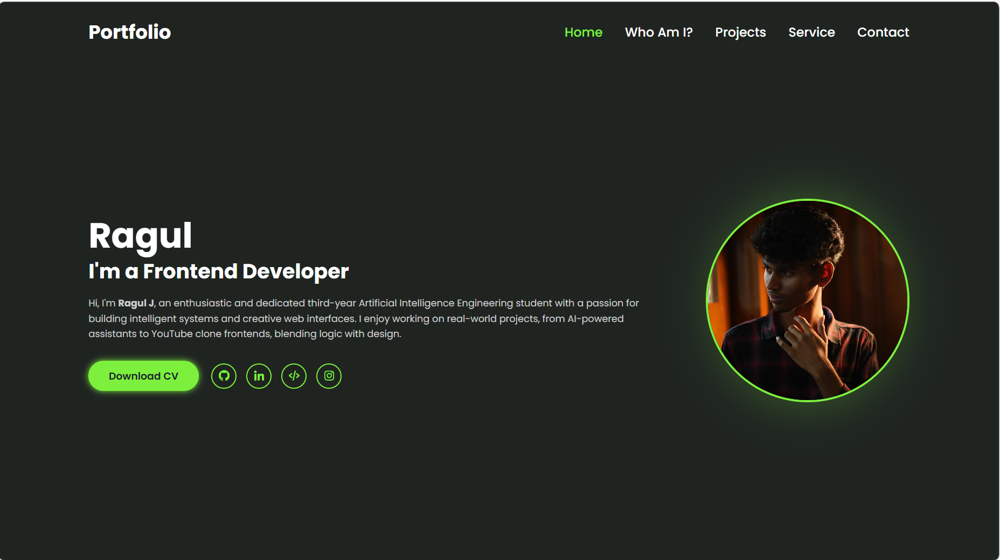

<<<<<<< HEAD
# React + Vite

This template provides a minimal setup to get React working in Vite with HMR and some ESLint rules.

Currently, two official plugins are available:

- [@vitejs/plugin-react](https://github.com/vitejs/vite-plugin-react/blob/main/packages/plugin-react) uses [Babel](https://babeljs.io/) for Fast Refresh
- [@vitejs/plugin-react-swc](https://github.com/vitejs/vite-plugin-react/blob/main/packages/plugin-react-swc) uses [SWC](https://swc.rs/) for Fast Refresh

## Expanding the ESLint configuration

If you are developing a production application, we recommend using TypeScript with type-aware lint rules enabled. Check out the [TS template](https://github.com/vitejs/vite/tree/main/packages/create-vite/template-react-ts) for information on how to integrate TypeScript and [`typescript-eslint`](https://typescript-eslint.io) in your project.
=======

A visually appealing and responsive portfolio website to showcase my projects, skills, and contact details.

## 🌟 Features
- Animated sections with Framer Motion
- 3D elements using Three.js
- Project showcase with GitHub links
- Contact form with email integration

## 🛠️ Tech Stack
- REACT
- HTML
- CSS
- JavaScript
- Three.js
- GSAP / Framer Motion

## 📸 Screenshots

## 🧪 How to Run Locally
1. Clone this repository
2. Open `index.html` in browser

## 📄 License
MIT
>>>>>>> fdc4e0561e7de4f766f2eef77196a83e906227ef
